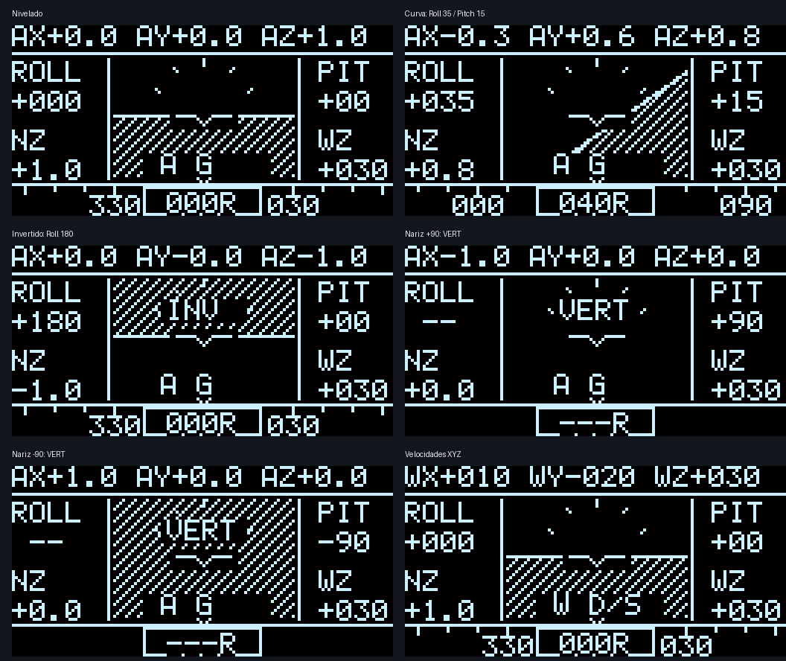
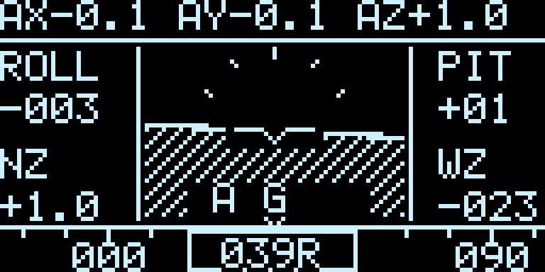

# Painel de voo e tratamento de inversões — 10/11/2026

## Versão anterior preservada

O pacote `Backups/versao-quaternion-estavel-20261110.tar.gz` preserva 33 arquivos da versão anterior: código, headers, testes, documentação, script de dependências, Makefile, linker, ELF, binário e registros de compilação/gravação/execução. Inclui um manifesto SHA-256; todos os arquivos foram relidos do pacote e tiveram os hashes verificados antes de iniciar as alterações.

O binário preservado tem SHA-256 `14ba156b9afb4ad0533652ece999e12f093923fa4fad4baf8971f83b977a226b`. O hash do pacote completo está em `Backups/versao-quaternion-estavel-20261110.sha256`. Os backups ficam fora de `build/` e são preservados por `make clean`.

Para voltar apenas ao executável anterior, extraia o pacote para outra pasta e grave seu `build/firmware.elf` pelo OpenOCD. Os fontes correspondentes também estão no pacote. Não é necessário reconstruir o executável para restaurá-lo.

## Organização da tela

O arranjo é inspirado em instrumentos de voo com indicador de atitude central e rumo abaixo, conforme a [descrição do arranjo básico T da FAA](https://hfcc.dot.gov/publications/docs/GeneralGuidance/zz_FAA_GeneralGuidanceDoc_Chapter_05_Section_01.html), adaptado às medidas disponíveis nesta IMU e ao OLED monocromático de 128×64 pixels.

| Região | Informação |
| --- | --- |
| Centro | Horizonte, solo pontilhado, céu escuro, marcas de banco e símbolo fixo da aeronave. |
| Lateral esquerda | Roll em graus e NZ, aceleração no eixo Z do sensor em g. |
| Lateral direita | Pitch em graus e WZ, velocidade angular Z em °/s. |
| Faixa inferior | Fita circular de rumo relativo 000…359; o R no campo central identifica referência relativa. |
| Faixa superior | AX/AY/AZ em g, alternando a cada 2 s com WX/WY/WZ em °/s. |
| Centro inferior | Unidade da faixa superior: `A G` ou `W D/S`. |
| Centro, quando aplicável | `INV` para atitude invertida; `VERT` quando heading/Roll de Euler estão indefinidos. |

O painel representa atitude e medições da IMU; não estima velocidade do ar ou altitude. A aceleração inclui a contribuição gravitacional. Yaw permanece relativo e sujeito à deriva residual.



## Proteções durante a inversão

O horizonte não depende de Roll/Pitch de Euler nem da tangente do Pitch. Para a gravidade unitária prevista no sensor, `g = (gx,gy,gz)`, o plano projetado no viewport é:

```text
h(x,y) = gz × (y − 30) + gy × (x − 64) + 20 × gx
h = 0: horizonte
h > 0: solo
```

Esse cálculo continua finito em ±90° e 180°. Ao ficar invertido, o solo passa para cima naturalmente. O viewport limita os pixels sem deformar extremidades de uma linha. Quaternions q e −q geram exatamente a mesma imagem.

As primitivas de pixel/linha agora recebem coordenadas com sinal. Pixels fora da tela são descartados, incluindo coordenadas negativas, evitando o retorno por overflow de `u8`.

Perto da vertical, o horizonte continua atualizando pelo quaternion. Roll numérico e rumo ficam sem valor, com `VERT`; eles reaparecem ao sair dessa região, usando a histerese já presente no filtro. Um rumo alterado em 180° ao atravessar a vertical pode ser a representação correta do eixo X projetado no plano horizontal, não uma falha de memória ou renderização.

Também foi tratado o equilíbrio antipodal da correção gravitacional: se a gravidade medida permanecer quase oposta à prevista por aproximadamente 0,5 s, com módulo do giroscópio abaixo de 5°/s e aceleração entre 0,85 e 1,15 g, o filtro aplica uma correção de inclinação. Isso evita ficar preso na atitude oposta quando o giro da inversão não foi adquirido. Lacunas de comunicação interrompem essa janela. Uma inversão normalmente acompanhada pelo quaternion não dispara a recuperação.

Essa recuperação não reconstrói o Yaw perdido em um movimento não medido: acelerômetro e giroscópio não fornecem uma referência absoluta de direção. Giros acima da faixa do sensor e acelerações externas também continuam limitando a precisão física.

## Verificação

`make test` passou com `-Wall -Wextra -Werror`, preservando os testes anteriores e acrescentando:

- Inicialização já invertida e recuperação de um estado exatamente oposto à gravidade.
- Interrupção da janela de recuperação após lacuna de aquisição.
- Voltas completas de 360° em Roll e Pitch, com quaternion finito, unitário e contínuo e sem recuperações indevidas.
- Solo abaixo em atitude normal, acima em atitude invertida, céu ao apontar para cima e solo ao apontar para baixo.
- Renderização idêntica para q/−q e para rumos equivalentes −1/359, 0/360, 1/361 e −180/180.
- Recorte de coordenadas negativas e manutenção de telemetria, erro de aquisição e envio incremental do OLED.

`make -j4` passou. A gravação via ST-LINK foi verificada com `Verified OK`, registrada em `build/panel-flash.log`. A assinatura de diagnóstico da nova versão é `0x49324334`.

Em `build/panel-runtime.log`, a placa em execução registrou **502 leituras válidas e 50 quadros em 5.017 ms**, aproximadamente 100,1 Hz e 10,0 Hz. Erros de IMU/OLED e prazos perdidos permaneceram em zero na janela. O maior intervalo entre leituras desde a inicialização foi 11 ms; houve uma tentativa de calibração. O contador de recuperações de inclinação permaneceu em zero nessa janela.



A imagem acima foi reconstruída da RAM da placa, não fotografada do painel físico. Os testes de inversão foram simulados; falta a comparação física controlada dos ângulos em uma referência de bancada.

Binário atual: `build/firmware.bin`, SHA-256 `a608bd687e6e9832e1b58ec082dc1f3516129b09f8b0ff113e70c7c860e00fc0`. Uso estimado: 34.680 bytes de Flash (text + data); BSS de 6.708 bytes, incluindo as reservas do linker.

Para recriar as prévias: `make test` e `python3 Tools/render_panel_previews.py` (requer Pillow no computador). Não há dependência de Python na placa.
