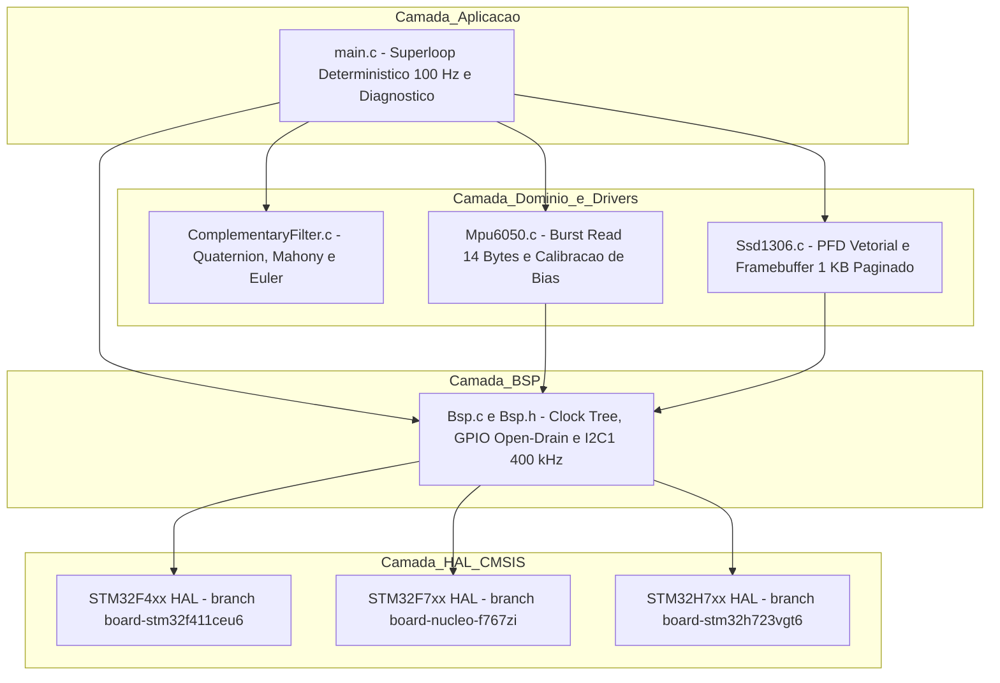
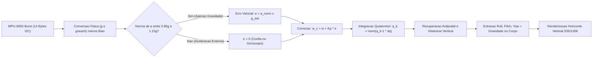
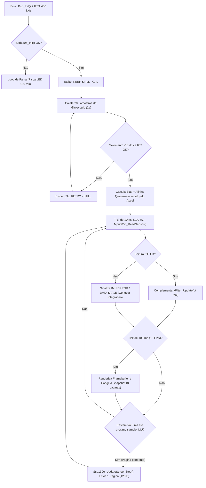
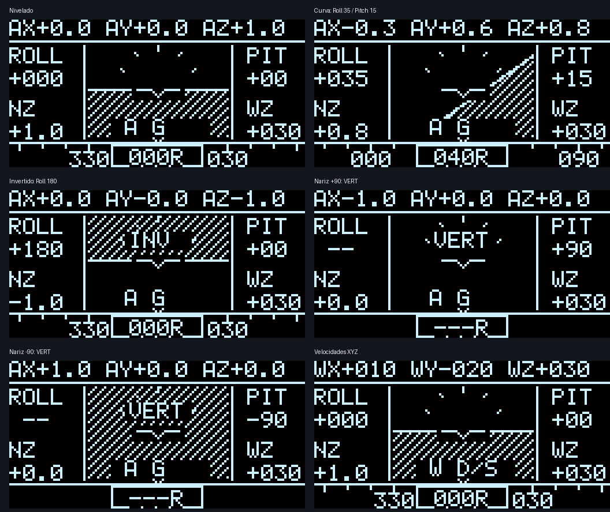
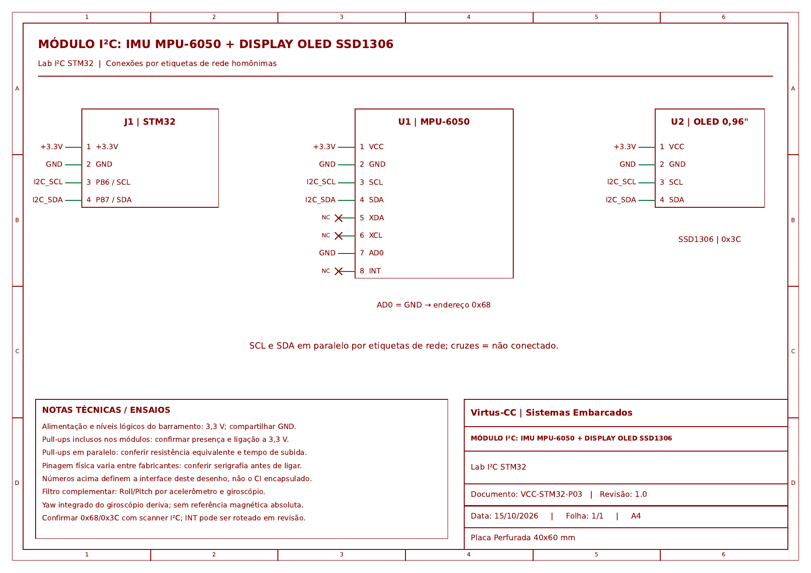

# Sistema de Estimação de Atitude e Painel de Voo Primário (AHRS / PFD) em STM32


**Formação em Sistemas Embarcados Virtus-CC — Curso 2: Introdução aos Microcontroladores de 32 bits (Bare-Metal)**  
**Prof. D.Sc. Rafael Bezerra Correia Lima**

> [!NOTE]
> **Padrão de Engenharia de Firmware:** A arquitetura modular em camadas, a nomenclatura tipada de identificadores, o isolamento via *Board Support Package* (`Bsp`), o encapsulamento de estado e a documentação Doxygen seguem as diretrizes do **Laboratório ASSERT (IFPB)**.

---

## Sumário

1. [Visão Geral do Projeto](#1-visão-geral-do-projeto)
2. [Branches e Suporte Multi-Placa (F411, F767, H723)](#2-branches-e-suporte-multi-placa-f411-f767-h723)
3. [Arquitetura de Software e Diagramas do Sistema](#3-arquitetura-de-software-e-diagramas-do-sistema)
4. [Painel de Voo Primário (PFD) no OLED 128x64](#4-painel-de-voo-primário-pfd-no-oled-128x64)
5. [Fundamentação Matemática: Filtro Complementar em Quaternion](#5-fundamentação-matemática-filtro-complementar-em-quaternion)
6. [Hardware e Pinagem de Conexão](#6-hardware-e-pinagem-de-conexão)
7. [Estrutura do Repositório](#7-estrutura-do-repositório)
8. [Como Rodar: Compilação, Testes Unitários e Gravação](#8-como-rodar-compilação-testes-unitários-e-gravação)
9. [Roteiro de Validação Física (Incrementos de 90 Graus)](#9-roteiro-de-validação-física-incrementos-de-90-graus)
10. [Documentação Técnica Complementar](#10-documentação-técnica-complementar)

---

## 1. Visão Geral do Projeto

Este projeto implementa um **Sistema de Referência de Atitude e Proa (AHRS)** embarcado em tempo real para estimação da pose tridimensional (**Roll, Pitch e Yaw**) de uma aeronave utilizando a unidade de medição inercial **MPU-6050 (6-DOF)** e visualização contínua em um display **OLED SSD1306 (128x64)** via barramento **I²C Fast-Mode (400 kHz)**.

### Principais Diferenciais Técnicos
- **Fusão Sensorial Não Linear em Quaternion ($SO(3)$):** Integração acoplada de velocidade angular nos 3 eixos com realimentação proporcional de gravidade inspirada no filtro explícito de **Mahony et al. (2008)**, eliminando o acoplamento espúrio de Yaw em atitudes inclinadas e o *gimbal lock* na integração interna.
- **Painel Aeronáutico Vetorial (Requisito Avançado):** Renderização contínua a **10 FPS** com horizonte artificial vetorial ($360^\circ$ e voo invertido `INV`), indicador de singularidade vertical (`VERT` com histerese), fita circular de rumo (`000R` a `359R`) e telemetria triaxial alternada (`g` e `°/s`).
- **Escalonamento Determinístico Não Bloqueante:** Amostragem prioritária da IMU a **100 Hz (10 ms)** desacoplada da atualização gráfica do OLED, que é fatiada em transferências de **1 página (128 bytes)** por ciclo respeitando uma janela mínima de guarda de **6 ms**.
- **Calibração Automática de Giroscópio no Boot:** Estimação de *bias* em repouso sobre 200 amostras com detecção automática de movimento (`KEEP STILL - CAL` / `CAL RETRY - STILL`).
- **Portabilidade Multi-Arquitetura (Cortex-M4 e Cortex-M7):** Código-fonte unificado compatível com **STM32F411CEU6**, **NUCLEO-F767ZI** e **STM32H723VGT6**.

---

## 2. Branches e Suporte Multi-Placa (F411, F767, H723)

O repositório mantém **3 branches dedicadas por placa** (além da `main`), compartilhando 100% da base de código de aplicação e selecionando automaticamente os parâmetros de compilação, *clock tree*, *timing* I²C e *linker script* de acordo com a branch ativa:

| Branch Git | Placa / Alvo | MCU / Arquitetura | Clock SYSCLK | Flash / RAM | LED Heartbeat | Alvo `Makefile` |
| :--- | :--- | :--- | :---: | :---: | :---: | :---: |
| `board/stm32f411ceu6` | **Black Pill V2.0** | `STM32F411CEU6` (Cortex-M4F) | `96 MHz` | `512 KB / 128 KB` | `PC13` | `BOARD=f411` |
| `board/nucleo-f767zi` | **NUCLEO-F767ZI** | `STM32F767ZIT6` (Cortex-M7F) | `216 MHz` | `2048 KB / 512 KB` | `PB0` | `BOARD=f767` |
| `board/stm32h723vgt6` | **DevEBox / H723** | `STM32H723VGT6` (Cortex-M7F) | `400 MHz` | `1024 KB / 564 KB` | `PC13` | `BOARD=h723` |
| `main` | **Branch Principal** | Multi-Target (Default `F411`) | Configurável | Configurável | Configurável | `BOARD=f411` |

### Alternando entre as Branches de Placa

```sh
# Para trabalhar/gravar na Black Pill (STM32F411CEU6)
git checkout board/stm32f411ceu6

# Para trabalhar/gravar na Nucleo-144 (STM32F767ZI)
git checkout board/nucleo-f767zi

# Para trabalhar/gravar na placa STM32H723VGT6
git checkout board/stm32h723vgt6
```

---

## 3. Arquitetura de Software e Diagramas do Sistema

### 3.1. Arquitetura em Camadas (Hardware Abstraction)



### 3.2. Pipeline de Fusão Sensorial (Filtro Complementar Não Linear)



### 3.3. Máquina de Estados e Escalonamento Real-Time do Superloop



---

## 4. Painel de Voo Primário (PFD) no OLED 128x64

O painel permanece visível continuamente na tela de 128x64 pixels sem páginas de menu bloqueantes:

- **Centro (Horizonte Artificial Vetorial):** Céu escuro, solo pontilhado e símbolo fixo da aeronave no centro. O desenho avalia diretamente o vetor de gravidade estimado pelo quaternion ($g_x, g_y, g_z$), garantindo continuidade geométrica em **qualquer inclinação de 360°**, incluindo voo invertido (`INV`):

$$
h(x,y) = g_z(y - 30) + g_y(x - 64) + 20g_x
$$

- **Colunas Laterais:** `R` (Roll) e `P` (Pitch) em graus à esquerda; `NZ` (carga normal no eixo Z em $g$) e `WZ` (velocidade angular Z em $^\circ/\text{s}$) à direita.
- **Faixa Superior (Multiplexada a cada 2 s):** Alterna automaticamente entre aceleração linear triaxial (`AX`, `AY`, `AZ` em $g$) e velocidade angular triaxial (`WX`, `WY`, `WZ` em $^\circ/\text{s}$), indicando a unidade ativa (`A G` ou `W D/S`).
- **Faixa Inferior (Fita de Proa Circular):** Bússola deslizante `000...359` com caixa central `000R` (o sufixo `R` destaca que o rumo é relativo à posição de inicialização, pois o MPU-6050 não possui magnetômetro).
- **Sinalização de Singularidade e Falhas:**
  - `INV`: Atitude invertida ($g_z < 0$).
  - `VERT`: Proximidade de Pitch $\pm 90^\circ$ ($|g_x| \ge 0.95$ com histerese), suprimindo valores ambíguos de Roll/Yaw enquanto o quaternion segue integrando normalmente.
  - `IMU ERROR / DATA STALE`: Exibido imediatamente se o barramento I²C sofrer desconexão, piscando o LED a `100 ms` (em operação normal o *heartbeat* ocorre a `500 ms`).



---

## 5. Fundamentação Matemática: Filtro Complementar em Quaternion

### 5.1. Alinhamento Inicial pelo Acelerômetro

$$
\text{Roll}_{\text{acc}} = \text{atan2}(A_y, A_z) \times \frac{180}{\pi}
$$

$$
\text{Pitch}_{\text{acc}} = \text{atan2}\left(-A_x, \sqrt{A_y^2 + A_z^2}\right) \times \frac{180}{\pi}
$$

### 5.2. Propagação Acoplada em Quaternion e Realimentação de Mahony
Para evitar o erro clássico de integrar $\omega_z$ diretamente como taxa de Yaw quando a aeronave possui Roll ou Pitch não nulos, a orientação é mantida por um quaternion unitário $q = [q_w, q_x, q_y, q_z]^T$.

1. **Direção Estimada da Gravidade no Referencial do Corpo ($\hat{g}_b$):**

$$
\hat{g}_b = \left[\, 2(q_x q_z - q_w q_y),\; 2(q_y q_z + q_w q_x),\; 1 - 2(q_x^2 + q_y^2) \,\right]^T
$$

2. **Erro de Orientação por Produto Vetorial e Ganho Proporcional ($K_p$):**

$$
e = \frac{a}{\lVert a \rVert} \times \hat{g}_b, \qquad K_p = -\frac{\ln(0.98)}{0.01} \approx 2.02\text{ rad/s}
$$

3. **Velocidade Angular Corrigida e Atualização por Mapa Exponencial ($\delta q$):**

$$
\omega_c = \omega_{\text{rad/s}} + K_p e, \qquad \beta = \frac{\lVert \omega_c \rVert \Delta t}{2}
$$

$$
\delta q = \left[\, \cos\beta,\; \frac{\sin\beta}{\lVert \omega_c \rVert}\omega_c \,\right], \qquad q_k = \text{normalize}(q_{k-1} \otimes \delta q)
$$

- **Gate Gravitacional:** A correção proporcional $K_p e$ só atua quando $0.85\text{ g} \le \lVert a \rVert \le 1.15\text{ g}$, rejeitando acelerações lineares externas.
- **Recuperação Antipodal:** Trata o ponto de equilíbrio instável ($\hat{g}_b \approx -a / \lVert a \rVert$) após manobras rápidas sem forçar o Yaw a zero.

---

## 6. Hardware e Pinagem de Conexão

| Módulo / Periférico | Black Pill (`F411`) | `STM32H723` | `NUCLEO-F767ZI` | Função / Observação |
| :--- | :---: | :---: | :---: | :--- |
| **VCC / VDD** | `3.3V` | `3.3V` | `3.3V` | Alimentação lógica e dos módulos |
| **GND** | `GND` | `GND` | `GND` | Referência de terra comum |
| **I2C1 SCL** | `PB6` | `PB6` | `PB6` | Clock I²C a 400 kHz (Open-Drain + Pull-up) |
| **I2C1 SDA** | `PB7` | `PB7` | `PB7` | Dados I²C (MPU-6050 `0x68` + OLED `0x3C`) |
| **MPU-6050 AD0** | `GND` | `GND` | `GND` | Fixa endereço I²C do MPU-6050 em `0x68` |
| **LED Heartbeat** | `PC13` | `PC13` | `PB0` | `500 ms` normal / `100 ms` falha de comunicação |

### Diagrama Esquemático do Circuito


> Versão vetorial para impressão/inspeção: [Docs/Esquematico_Placa3_I2C_MPU6050_OLED.pdf](Docs/Esquematico_Placa3_I2C_MPU6050_OLED.pdf)

---

## 7. Estrutura do Repositório

```text
lab3-i2c-imu-oled/
├── Core/
│   ├── Inc/
│   │   ├── AssertTypes.h             # Tipos padronizados de largura fixa (u8, s16, u32...)
│   │   ├── Bsp.h                     # Interface do Board Support Package (F4 / F7 / H7)
│   │   ├── ComplementaryFilter.h     # Interface e struct do filtro em quaternion
│   │   ├── Mpu6050.h                 # Registradores e tipos de dados da IMU MPU-6050
│   │   ├── Ssd1306.h                 # API grafica e renderizador do painel OLED 128x64
│   │   ├── main.h                    # Diagnostico em RAM e constantes do superloop
│   │   └── stm32{f4,f7,h7}xx_hal_conf.h
│   └── Src/
│       ├── Bsp.c                     # Inicializacao de Clock, GPIO e I2C1 multi-placa
│       ├── ComplementaryFilter.c     # Matematica de quaternion, Mahony e extracao Euler
│       ├── Mpu6050.c                 # Driver I2C burst e calibracao de bias do giroscopio
│       ├── Ssd1306.c                 # Horizonte artificial vetorial, fita de proa e paginacao
│       ├── main.c                    # Superloop deterministico (100 Hz IMU / 10 Hz OLED)
│       ├── stm32f4xx_it.c            # Handler de interrupcao SysTick (HAL_IncTick)
│       └── sysmem.c                  # Gerenciamento de heap (_sbrk) com guarda de stack
├── Docs/                             # Esquematicos, relatorios de validacao e matematica
├── Tests/
│   ├── Stubs/stm32f4xx_hal.h         # Mocks/Stubs do barramento I2C e SysTick para host
│   └── test_firmware.c               # Suite de testes automatizados (trajetorias 3D + OLED)
├── Tools/
│   ├── fetch_dependencies.sh         # Provisionamento reprodutivel dos drivers CMSIS/HAL
│   └── render_panel_previews.py      # Gerador de imagens PNG a partir do framebuffer real
├── Makefile                          # Sistema de build multi-placa, testes e gravacao
├── STM32F411CEUx_FLASH.ld            # Linker script para STM32F411CEU6
├── STM32F767ZITx_FLASH.ld            # Linker script para NUCLEO-F767ZI
└── STM32H723VGTx_FLASH.ld            # Linker script para STM32H723VGT6
```

---

## 8. Como Rodar: Compilação, Testes Unitários e Gravação

### 8.1. Pré-requisitos
- **Linux / macOS / WSL** com `git`, `make`, compilador host `cc` (`gcc`/`clang`) e `openocd`.
- **Toolchain ARM Bare-Metal (`arm-none-eabi-gcc`):** Detectado automaticamente caso o **STM32CubeIDE** esteja instalado em `/opt/st`, ou utilizado diretamente do `PATH`.

### 8.2. Baixar Dependências HAL/CMSIS
Na primeira execução após clonar o repositório, popule a pasta `Drivers/` (ignorada pelo Git para manter o repositório leve):

```sh
sh Tools/fetch_dependencies.sh
```

### 8.3. Executar a Suíte de Testes Unitários (No Computador Host)
Os testes compilam o código real dos módulos `Mpu6050.c`, `ComplementaryFilter.c` e `Ssd1306.c` contra um barramento I²C simulado, validando 20 trajetórias 3D, inversões de $360^\circ$, recuperação antipodal e renderização pixel a pixel do OLED:

```sh
make test
```

### 8.4. Compilar o Firmware Bare-Metal
O `Makefile` detecta automaticamente a branch atual (`board/stm32f411ceu6`, `board/nucleo-f767zi` ou `board/stm32h723vgt6`). Você também pode especificar a placa explicitamente com `BOARD=`:

```sh
# Compila para a placa correspondente à branch atual
make clean && make -j4

# Ou compile explicitamente para qualquer uma das 3 placas:
make clean && make BOARD=f411 -j4   # Black Pill STM32F411CEU6
make clean && make BOARD=f767 -j4   # Nucleo-144 STM32F767ZI
make clean && make BOARD=h723 -j4   # STM32H723VGT6
```

Os artefatos gerados ficam em `build/firmware.elf`, `build/firmware.bin` e `build/firmware.map`.

### 8.5. Gravar na Placa via ST-Link (OpenOCD)

```sh
# Grava, verifica a Flash e reinicia o microcontrolador da branch ativa
make flash

# Ou especificando o alvo manualmente:
make flash BOARD=f411
make flash BOARD=f767
make flash BOARD=h723
```

---

## 9. Roteiro de Validação Física (Incrementos de 90 Graus)

1. **Calibração no Boot (`0s – 2s`):** Energize a placa sobre uma superfície plana e imóvel enquanto o OLED exibe `KEEP STILL - CAL`.
2. **Repouso Nivelado (`0°`):** Verifique `R +000`, `P +000`, `NZ +1.0g`, `WZ +000` e a linha do horizonte perfeitamente alinhada às asas centrais da aeronave.
3. **Teste de Roll (`±90°` em torno de X):** Incline a montagem $+90^\circ$ para a direita e $-90^\circ$ para a esquerda. Observe `R` atingir $\approx \pm 90^\circ$ e a linha do horizonte girar verticalmente.
4. **Teste de Pitch (`±90°` em torno de Y):** Retorne ao plano e incline o nariz $+90^\circ$ para cima e $-90^\circ$ para baixo. Observe `P` atingir $\approx \pm 90^\circ$ e o aviso `VERT` indicando a singularidade de Euler nas proximidades de $\pm 90^\circ$.
5. **Teste de Voo Invertido (`180°`):** Vire a placa de cabeça para baixo ($A_z \approx -1.0\text{ g}$). O indicador `INV` acende e o horizonte artificial mantém a orientação física sem saltos.
6. **Teste de Yaw (Giro no Plano Horizontal):** Gire a placa sobre a bancada em incrementos de $90^\circ$ e acompanhe a fita circular de rumo (`000R` $\rightarrow$ `090R` $\rightarrow$ `180R` $\rightarrow$ `270R`) e a taxa `WZ`.

---

## 10. Documentação Técnica Complementar

- **[Especificação e Validação do Painel de Voo (PFD)](Docs/Painel_Voo.md):** Anatomia detalhada dos indicadores visuais e captura real em bancada.
- **[Formulação em Quaternion e Correção do Acoplamento de Yaw](Docs/Correcao_Yaw.md):** Dedução matemática completa e análise de singularidades.
- **[Relatório de Validação de Firmware e Orçamento Temporal I²C](Docs/Validacao_Firmware.md):** Medições em hardware real via SWD (`g_appDiagnostics`), *timing* de páginas do OLED e backup de Flash.
